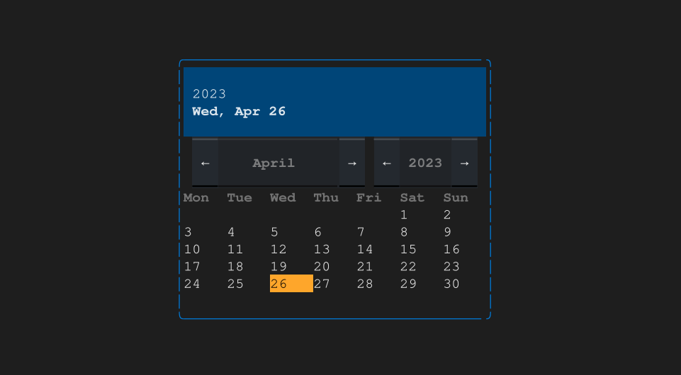

# textual-datepicker

> [!IMPORTANT]
> `textual-datepicker` was built as an experiment in the early days of Textual.
> This no longer works in recent versions and the repository has been archived.
>
> A Textual built-in date picker widget is apparently still on the 
> [roadmap](https://textual.textualize.io/roadmap/) (as of Oct 2025).
>
> I haven't tested this project myself, but perhaps consider
> [textual-timepiece](https://github.com/ddkasa/textual-timepiece)
> which provides a date picker and many other time related widgets.

A Textual widget for a simple date picker

## Licence

Licensed under the [GNU General Public License v3.0](LICENSE).
